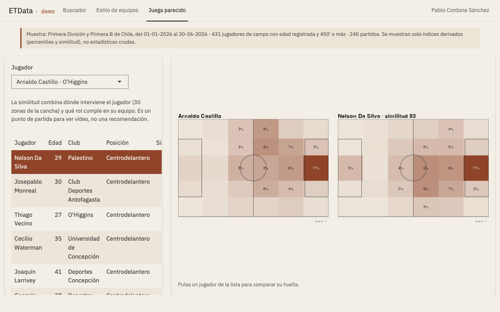
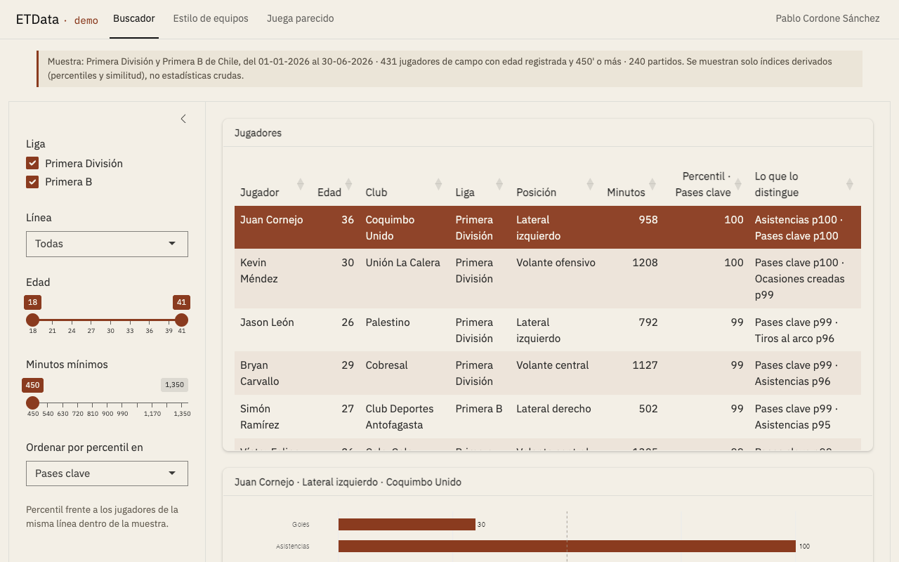
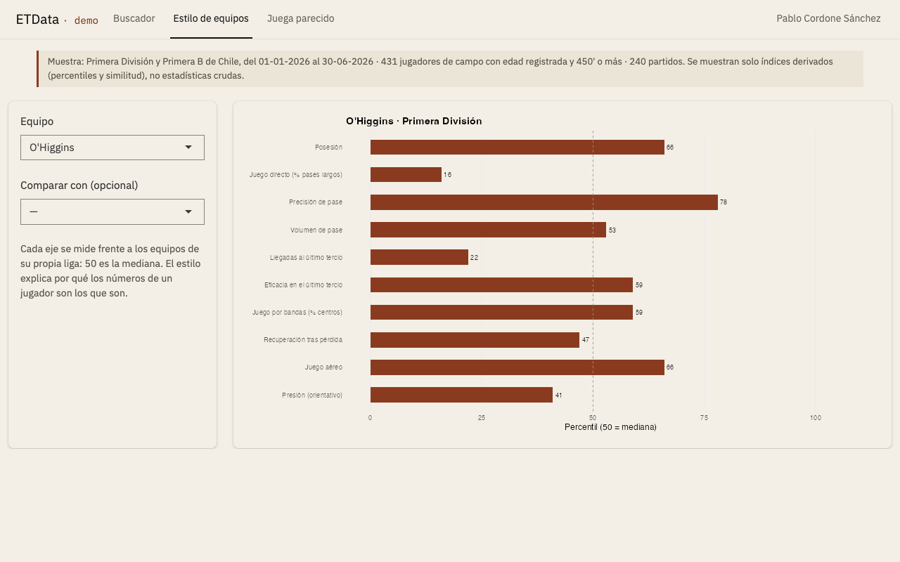

# ETData · Sistema de análisis y scouting de fútbol

ETData es la plataforma que desarrollo desde 2023 para encontrar jugadores, compararlos y evaluar cómo rendirían en otro equipo. La construí para trabajar sin licencias comerciales y la uso en informes para agencias de representación.

**[Abrir el demo](https://pablocordone.shinyapps.io/etdata-demo/)** · muestra de datos con funciones limitadas.

## Qué hace el sistema completo

- **Base de datos propia** sobre DuckDB: 18.558 partidos registrados, 11.589 con estadística individual, 38.696 jugadores y 91 competiciones (conteo del 01-11-2026), alimentada con procesos automáticos de captura de datos públicos de eventos.
- **Indicadores propios:** IRP (nota de rendimiento por partido) e IAV (acciones con y sin balón ponderadas en goles), siempre leídos contra la posición del jugador.
- **Contexto:** el estilo de cada equipo medido frente a su liga y el rol del jugador dentro de su plantel. El mismo jugador produce números distintos en equipos distintos.
- **Encaje en el club comprador:** proyección de cómo cambiarían sus números en otro sistema de juego y compatibilidad de estilo entre ambos equipos.
- **Jugadores similares:** por rendimiento y por cómo juegan (dónde intervienen en 30 zonas de la cancha y qué rol cumplen).
- **xG propio** para ligas donde el proveedor no lo publica.
- **Videoanálisis con protocolo:** libro de 37 acciones codificadas, orden ciego y cada observación citada con su clip.
- **Informes** reproducibles en PDF (español, inglés y portugués).

## Cómo trabajo

1. **Perfil:** parto de lo que pide el cuerpo técnico, no del jugador.
2. **Filtro:** reduzco el universo a una lista corta comparando a cada jugador con su posición y su liga.
3. **Encaje:** estimo cómo rendiría en el sistema del club que lo recibe.
4. **Vídeo:** codifico sus partidos con protocolo, antes de mirar sus cifras.
5. **Informe:** cada número sale de un script que se puede volver a correr; cada afirmación cualitativa cita un clip.

## Cada modelo se pone a prueba

| Modelo | Prueba | Resultado |
|---|---|---|
| Proyección al club comprador | 600 traspasos reales: error frente a suponer que el jugador repite sus números | −17 % (mediana) |
| Juega parecido | Encontrar al mismo jugador entre los 5 más parecidos usando la otra mitad de su temporada | 41 % |
| IAV | Estabilidad entre mitades de temporada (defensas · volantes · delanteros) | 0,72 · 0,68 · 0,67 |
| xG propio | Capacidad de separar los tiros que terminan en gol (AUC) | 0,76 |

Un control mensual automatizado vuelve a correr 19 pruebas y avisa si algún índice baja de su umbral (última corrida: 01-11-2026).

## El demo

Muestra: Primera División y Primera B de Chile, del 01-01-2026 al 30-06-2026; 431 jugadores de campo con edad registrada y 450 minutos o más; 240 partidos.

- **Buscador:** filtros por liga, línea, edad y minutos, con percentiles por posición.
- **Estilo de equipos:** perfil de cada equipo frente a su liga, solo o comparado con otro.
- **Juega parecido:** los 10 jugadores con la huella de juego más parecida, con sus mapas de 30 zonas.

El demo trabaja sobre **índices ya calculados** (percentiles y similitud). No incluye el motor de cálculo ni estadísticas crudas, y el archivo de datos no está en este repositorio. Cada pestaña se puede abrir directamente con `?tab=buscador`, `?tab=estilo` o `?tab=parecido`.

| Buscador | Estilo de equipos |
|---|---|
|  |  |

## Lo que el sistema no mide

Datos físicos (distancia, sprints, carga) ni la posición de los 22 jugadores en cada momento. El juego sin balón se evalúa en vídeo y la comparación entre ligas de distinto nivel se lee con cautela.

## Herramientas

R (Shiny, bslib, tidyverse, DuckDB, ggplot2), Quarto/R Markdown, pagedown y Python para la captura de datos.

- **R** 4.5.1. R Core Team (2025). R: A Language and Environment for Statistical Computing.
- **shiny** 1.11.1. Winston Chang, Joe Cheng, JJ Allaire y otros (2025). shiny: Web Application Framework for R.
- **bslib** 0.9.0. Carson Sievert, Joe Cheng, Garrick Aden-Buie (2025). bslib: Custom 'Bootstrap' 'Sass' Themes for 'shiny' and 'rmarkdown'.
- **DBI** 1.2.3. R Special Interest Group on Databases (R-SIG-DB), Hadley Wickham, Kirill Müller (2024). DBI: R Database Interface.
- **duckdb** 1.5.2. Hannes Mühleisen, Mark Raasveldt (2026). duckdb: DBI Package for the DuckDB Database Management System.
- **dplyr** 1.1.4. Hadley Wickham, Romain François, Lionel Henry y otros (2023). dplyr: A Grammar of Data Manipulation.
- **tidyr** 1.3.1. Hadley Wickham, Davis Vaughan, Maximilian Girlich (2024). tidyr: Tidy Messy Data.
- **ggplot2** 4.0.1. Hadley Wickham (2016). ggplot2: Elegant Graphics for Data Analysis.
- **ggsoccer** 0.2.0. Ben Torvaney (2024). ggsoccer: Plot Soccer Event Data.
- **plotly** 4.11.0. Carson Sievert (2020). Interactive Web-Based Data Visualization with R, plotly, and shiny.
- **DT** 0.33. Yihui Xie, Joe Cheng, Xianying Tan (2024). DT: A Wrapper of the JavaScript Library 'DataTables'.
- **stringi** 1.8.7. Marek Gagolewski (2022). {stringi}: {F}ast and portable character string processing in {R}.
- **jsonlite** 2.0.0. Jeroen Ooms (2014). The jsonlite Package: A Practical and Consistent Mapping Between JSON Data and R Objects.
- **rmarkdown** 2.29. JJ Allaire, Yihui Xie, Christophe Dervieux y otros (2024). rmarkdown: Dynamic Documents for R.
- **knitr** 1.50. Yihui Xie (2025). knitr: A General-Purpose Package for Dynamic Report Generation in {R}.
- **xaringan** 0.31. Yihui Xie (2025). xaringan: Presentation Ninja.
- **pagedown** 0.23. Yihui Xie, Romain Lesur, Brent Thorne y otros (2025). pagedown: Paginate the HTML Output of R Markdown with CSS for Print.
