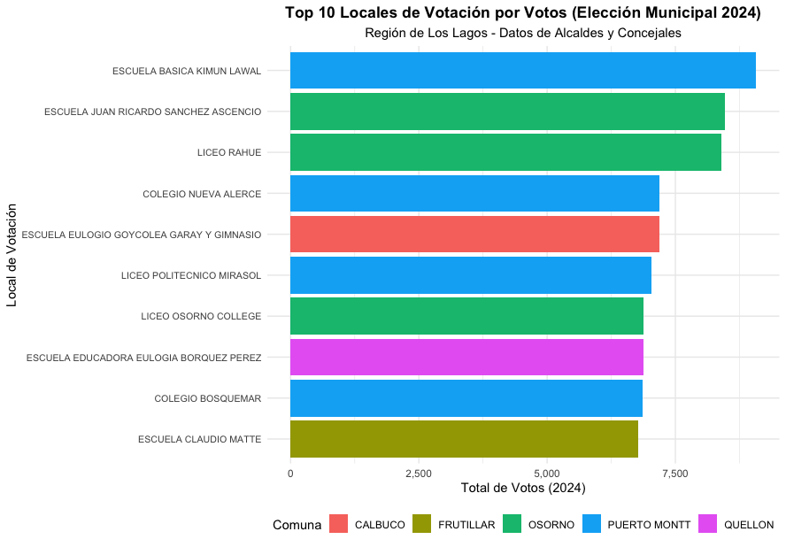

# SIG electoral · Región de Los Lagos

Aplicación Shiny para analizar resultados electorales en el territorio: por comuna y por local de votación, con mapas interactivos (Leaflet) y filtros por elección, partido y candidatura.

## Qué hace

- Integra resultados oficiales por mesa (73.824 filas) de 10 tipos de elección: concejal, constitucionales, gobernador regional (1ra vuelta), gobernador regional (2da vuelta), municipal (alcalde), parlamentaria, plebiscito constitucional, presidencial (1ra vuelta), presidencial (2da vuelta), regional.
- Años incluidos: 2021, 2023, 2024.
- Dos vistas: **mapa por comunas** (votos agregados por comuna) y **mapa por locales de votación** (cada local con su votación).
- Limpieza y unificación de nombres de comunas, locales y candidaturas entre fuentes distintas.

## Qué hay aquí

- `app/app.R`: la aplicación. Los datos procesados y las capas geográficas no se incluyen.

## Herramientas

R, Shiny, Leaflet, sf, dplyr y stringr.

Es un proyecto que me gustaría retomar. Lo dejo aquí como muestra de análisis territorial aplicado.
